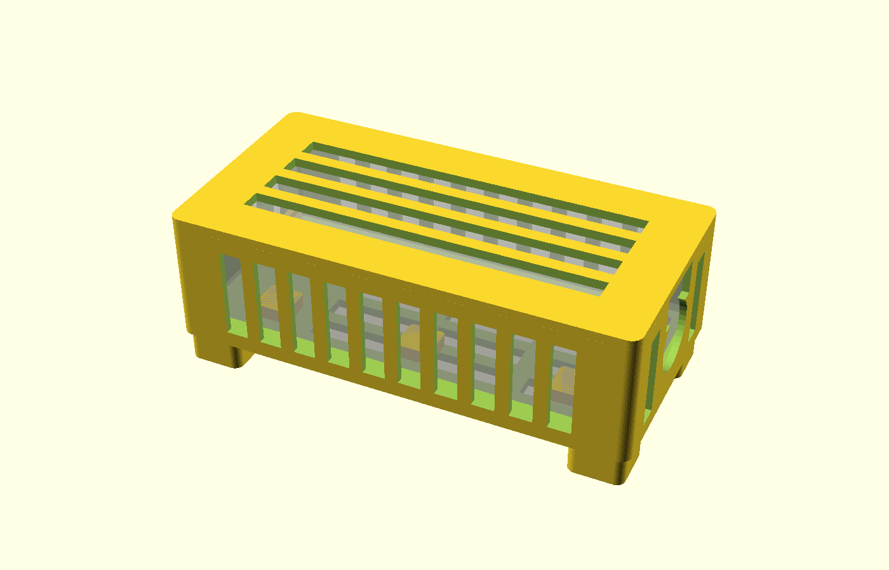

# MSI 400W 充電器散熱架 (A23-400P1A)

給 MSI Raider A18 HX 的 400W 變壓器 (20V / 20A) 用的 3D 列印通風盒。
目的：變壓器不直接貼地、四面都有空氣流通，熱不會悶在裡面，也不會把地板烤熱。



## 散熱設計
| 位置 | 作法 |
|---|---|
| 離地 | 4 隻 14mm 高的腳，底板和地板之間有空氣層，熱不會直接傳到地板 |
| 底板 | 整面開孔，冷空氣從底下補進來 |
| 變壓器底面 | 6 個 6mm 墊塊把變壓器抬起，底面也能散熱 (不是整片貼在底板上) |
| 兩長邊 | 整排直槽，煙囪效應：下進、上出 |
| 兩短邊 | U 型缺口讓 DC / AC 電線從上方放入，旁邊再各開直槽 |
| 蓋子 | 長條散熱孔 (可選)，只是擋灰塵和碰觸；夏天或長時間滿載建議不要蓋 |

## 尺寸
變壓器尺寸取自 ChargerLab 對 A23-400P1A 的拆解實測：
**188.09 × 88.17 × 33.20 mm** (長 × 寬 × 厚，不含電線護套)。
設計值各進位並留公差：

```
ad_L = 189   // 長
ad_W = 89    // 寬
ad_H = 34    // 厚
```
這是網路上的資料，不是量你手上那顆的結果。拿游標卡尺量過，若有出入就改 `msi_charger_box.scad` 開頭三個數字，其餘自動計算。

盒子外形約 201 × 101 × 68mm (含腳)；蓋子 201 × 101 × 7mm。

## 檔案
| 檔案 | 用途 |
|---|---|
| `plate.3mf` | 盒身 + 蓋子排在同一個板上，一次切片 (需要 ≥ 220mm 的 Y 軸，如 Bambu 256mm 床) |
| `box.3mf` / `lid.3mf` | 盒身、蓋子各自一個檔 |
| `box.stl` / `lid.stl` / `plate.stl` | 同上的 STL 版本 |
| `msi_charger_box.scad` | 參數式原始檔 |

## 列印
- 材料：**PETG 或 ABS/ASA** (PLA 約 55–60°C 就會軟化，不建議)
- 層高 0.2mm、牆 3 圈、填充 20%，不需要支撐
- 盒身以腳朝下列印；蓋子已翻面，平面朝下
- 3MF 只含幾何，沒有切片設定，材料與參數請在切片軟體內設定
- 重新輸出：
  ```
  openscad -o box.3mf   -D 'part="box"'  msi_charger_box.scad
  openscad -o lid.3mf   -D 'part="lid"'  msi_charger_box.scad
  openscad -o plate.3mf -D 'part="both"' msi_charger_box.scad
  ```

## 使用注意
- 放在硬質平面上，不要放在地毯/棉被上，也不要在上面堆東西
- 腳底可貼止滑墊
- 電線缺口不要把電線拉得太緊；AC 端的線不要壓在變壓器上
